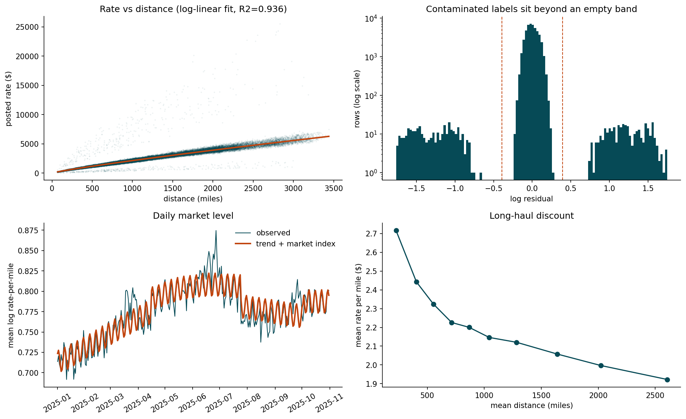

# Exploratory data analysis

Generated by `python scripts/run_eda.py`. Every number quoted in the README, the report or a module docstring is reproduced here.

## Coverage

| file           |   rows | first_date | last_date  | has_target |
|:---------------|-------:|:-----------|:-----------|:-----------|
| train_test     | 48,000 | 2025-01-01 | 2025-10-31 | yes        |
| validation     | 12,000 | 2025-11-01 | 2025-12-31 | no         |
| december_chart |     31 | 2025-12-01 | 2025-12-31 | no         |

## Missing values

| column       | train_missing | validation_missing |
|:-------------|--------------:|-------------------:|
| weight       |           300 |                165 |
| market_index |           374 |                249 |
| posted_rate  |             0 |             12,000 |

## Geography

| measure                             | value  |
|:------------------------------------|:-------|
| cities (both files)                 | 72     |
| cities in training                  | 64     |
| cities only in scored data          | 8      |
| scored rows touching an unseen city | 12.1%  |
| corr(great circle, distance)        | 0.9995 |
| median circuity                     | 1.182  |
| rows with circuity > 1.6            | 111    |
| distance floor (miles)              | 70.000 |

## Rate per mile by distance decile

| decile | distance |    rate | rate_per_mile |
|-------:|---------:|--------:|--------------:|
|      0 |  226.264 | 605.345 |         2.716 |
|      1 |  404.801 | 987.063 |         2.442 |
|      2 |  553.959 | 1,286.7 |         2.324 |
|      3 |  713.985 | 1,588.5 |         2.226 |
|      4 |  867.177 | 1,907.0 |         2.200 |
|      5 |  1,043.9 | 2,239.9 |         2.146 |
|      6 |  1,282.8 | 2,718.8 |         2.121 |
|      7 |  1,639.2 | 3,371.7 |         2.058 |
|      8 |  2,021.5 | 4,033.5 |         1.997 |
|      9 |  2,605.5 | 5,002.3 |         1.922 |

## Equipment premium

| equipment |  loads | rate_per_mile | log_residual |
|:----------|-------:|--------------:|-------------:|
| Dry Van   | 27,202 |         2.115 |      -0.0441 |
| Flatbed   |  8,753 |         2.295 |       0.0351 |
| Reefer    | 12,045 |         2.383 |       0.0741 |

## Log-residual bands

| abs log-residual band | rows |
|:----------------------|-----:|
| 0.2-0.3               |  129 |
| 0.3-0.4               |    0 |
| 0.4-0.5               |    0 |
| 0.5-0.7               |    1 |
| 0.7+                  |  676 |

## Market signals

| measure                                 |   value |
|:----------------------------------------|--------:|
| corr(quote_signal, rate)                | -0.0399 |
| corr(market_index, rate) per row        |  0.0342 |
| corr(market_index, rate-per-mile) daily |  0.6618 |
| level trend per day (log)               |  0.0002 |
| level market_index coefficient          |  0.1440 |
| trend across the training window (%)    |   6.970 |

